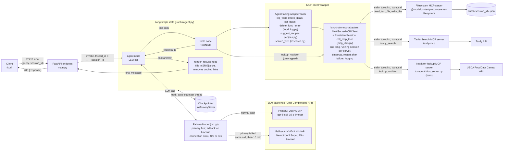
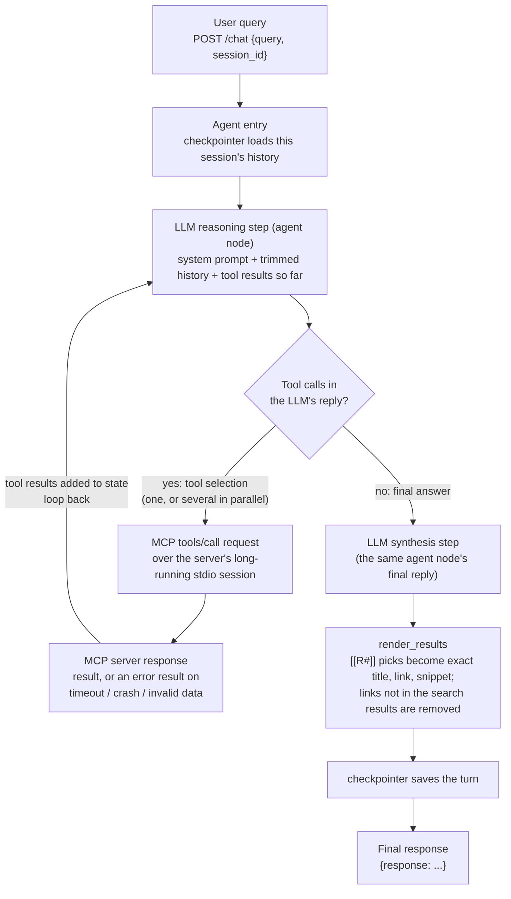
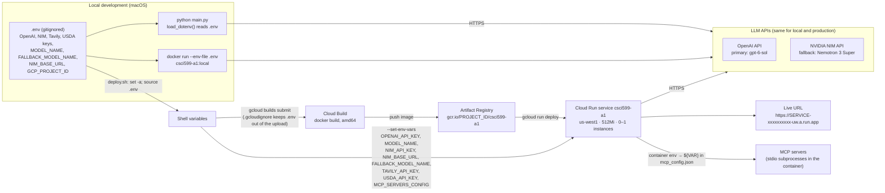

# Macro-Tracking Agent

A tool-using LLM agent that logs what you eat, tracks it against daily calorie and macro
goals, and finds recipes that fit what's left. Built with **LangGraph + FastAPI**, using
**three MCP servers** over real `tools/list` / `tools/call`, conversational memory keyed by
`session_id`, and deployed to **Google Cloud Run**. The LLM is OpenAI's `gpt-6-sol`, with
NVIDIA NIM's Nemotron 3 Super as an automatic fallback (see [LLM](#llm-primary-and-fallback)).

A live deployment exists but its address isn't published here; a demo is available on
request. To try the agent, deploy your own copy (see [Deployment](#deployment)) and set
`URL` to its address.

```bash
curl -X POST "$URL/chat" \
  -H "Content-Type: application/json" \
  -d '{"query": "I had two boiled eggs and a banana for breakfast", "session_id": "demo-1"}'
```

The first request after the service has been idle ~15 minutes pays a cold start of about
8–16 s on top of the normal response time (measured three times: 13.1 s, 18.0 s and 18.7 s end
to end for a simple question). Later requests answer in the times listed under
[Testing and verification](#testing-and-verification).

---

## Contents

1. [What it does](#what-it-does)
2. [API](#api)
3. [Try it](#try-it)
4. [Architecture](#architecture) (Diagram 1)
5. [Tool invocation flow](#tool-invocation-flow) (Diagram 2)
6. [LLM: primary and fallback](#llm-primary-and-fallback)
7. [MCP servers](#mcp-servers)
8. [Sessions, memory and stored data](#sessions-memory-and-stored-data)
9. [Failure handling](#failure-handling)
10. [Design decisions](#design-decisions)
11. [Setup and running locally](#setup-and-running-locally)
12. [Deployment](#deployment) (Diagram 3)
13. [Cost](#cost)
14. [Testing and verification](#testing-and-verification)
15. [Known limitations](#known-limitations)
16. [Development phases](#development-phases)
17. [Project layout](#project-layout)
18. [Third-party software](#third-party-software)

---

## What it does

| You say | The agent does | Tools | Multi-step? |
|---|---|---|---|
| "I had a banana and some almonds" | Looks up each food in USDA data, logs it, reports today's totals | `lookup_nutrition` → `log_food` | **Yes** (2 tool rounds) |
| "Yesterday I had a large pizza" | Logs it on yesterday's date, not today's | `log_food` (with `date: "yesterday"`), usually after `lookup_nutrition` | Usually |
| "Sorry, it was 2 eggs, not 3" / "Delete my lunch" | Finds the entry, deletes it, and for a correction logs the right values | `check_goals` → `delete_food_entry` (→ `log_food`) | **Yes** (2–3 rounds) |
| "How am I doing today?" / "What did I eat for lunch?" | Reads today's log and remaining budget | `check_goals` | No (1 tool call) |
| "My goal is 1,800 calories and 120 g protein a day" | Saves the new goals; budgets and recipe tiers use them from then on | `set_goals` | No |
| "What should I have for dinner?" | Checks the remaining budget, then searches recipes in three calorie tiers | `check_goals` → `suggest_recipes` | **Yes** (2 rounds) |
| "Had pizza for lunch, any dinner ideas?" | Logs first, then plans with the updated budget | `lookup_nutrition` → `log_food` → `check_goals` → `suggest_recipes` | **Yes** (3–4 rounds) |
| "Search the web for…" / "What does recent research say about…" | Searches the web once and answers from the results, citing them | `search_web` | No |
| "How much protein is in an egg?" / "How do I poach an egg?" | Answers from the model's own knowledge | none | No |
| "What did I ask you last?" | Answers from conversation memory | none | No |

"Multi-step" means the LLM calls a tool, reads the result and then calls another tool before
answering (the `tools → agent` loop in [Diagram 2](#tool-invocation-flow)); each round is one
more LLM call. Several tool calls in the same round (e.g. two `lookup_nutrition` calls for two
foods) run in parallel and count as one step.

Default daily goals until the user sets their own: 2,000 kcal, 150 g protein, 200 g carbs,
65 g fat. `set_goals` checks values against sanity ranges (e.g. 800–6,000 kcal).

## API

```
POST /chat
Request:  { "query": string, "session_id": string }
Response: { "response": string }
```

- The server reads `PORT` from the environment (default 8080) and binds `0.0.0.0`.
- Every well-formed request returns HTTP 200 with `{"response": ...}`, including when a tool,
  an MCP server or the LLM fails; the text then explains the problem. A request whose `query`
  or `session_id` is missing, empty or only whitespace gets FastAPI's standard 422 validation
  error (an empty `session_id` would otherwise make every such caller share one session).
- Requests for the same `session_id` run one at a time; different sessions run in parallel.
  Two overlapping requests for one session would otherwise each act on the other's message
  (found in testing: a sandwich logged twice).
- The same `session_id` continues a conversation and its food log; a different one starts
  fresh. There is no authentication: anyone who sends a `session_id` gets that session.

## Try it

Run these in order; they share one `session_id` so later requests build on earlier ones. The
helper is plain `curl` and prints the reply, then the HTTP status and time taken. If the
service has been idle, the first request also pays a cold start (15–20 s).

```bash
URL=https://YOUR-SERVICE-xxxxxxxxxx-uw.a.run.app   # your own deployment, or http://localhost:8080
chat() { curl -s -w '\n[%{http_code}, %{time_total}s]\n' -X POST "$URL/chat" \
  -H "Content-Type: application/json" -d "{\"query\": \"$1\", \"session_id\": \"$2\"}"; }
```

| # | Command | What to expect |
|---|---|---|
| 1 | `chat "How much protein is in an egg?" try-1` | Answered from the model's knowledge; no tool call |
| 2 | `chat "I had two boiled eggs and a banana for breakfast" try-1` | `lookup_nutrition` (USDA) for each food, then `log_food`; reply gives the totals |
| 3 | `chat "For lunch I had grilled chicken breast, a cup of white rice, broccoli and an apple" try-1` | Four lookups in parallel, then four log entries (multi-step) |
| 4 | `chat "List the entries logged today with their entry IDs" try-1` | `check_goals` reads the session's file; the IDs exist only there, so this shows the filesystem server is used |
| 5 | `chat "What should I have for dinner?" try-1` | `check_goals` → `suggest_recipes`: Light / Medium / Hearty picks with real links, sized to what's left of the day's budget (multi-step) |
| 6 | `chat "Sorry, it was one boiled egg, not two" try-1` | `check_goals` → `delete_food_entry` → `log_food`; totals drop accordingly (multi-step) |
| 7 | `chat "I want to make a chicken stir fry but I don't have chicken" try-1` | Ingredient swap answered from knowledge; no search |
| 8 | `chat "Search the web for recent research on creatine and cognition" try-1` | One `search_web` call; answer cites the links it found |
| 9 | `chat "What did I ask you last?" try-1` | Conversation memory recalls request 8 |
| 10 | `chat "What have I eaten today? And what did I ask you before?" try-2` | New session: no memory and an empty food log, by design |
| 11 | `curl -s -w '\n[%{http_code}]\n' -X POST "$URL/chat" -H "Content-Type: application/json" -d '{"query": "hi"}'` | HTTP 422: `session_id` is required |

Every request except the last returns HTTP 200 with `{"response": ...}`. The tool calls behind
each answer appear in Cloud Run's logs (`MCP tools/call ...`, `tool calls: [...]`).

---

## Architecture

**Diagram 1: system architecture.** Every box is a real component in this repository or a
service it calls.



- **FastAPI (`main.py`)** owns startup: it reads the server manifest `mcp_config.json`, runs
  `tools/list` against each server, builds the tool list and compiles the graph. Servers that
  fail discovery are skipped and retried later (see [Failure handling](#failure-handling)).
- **The graph (`agent.py`)** has three nodes: `agent` (LLM), `tools` (LangGraph's `ToolNode`)
  and `render_results` (plain code, no LLM).
- **The LLM (`llm.py`)** is one tool-bound model on each of two providers behind a small
  `FailoverModel`; see [LLM: primary and fallback](#llm-primary-and-fallback).
- **The MCP client wrapper** is `langchain-mcp-adapters`' `MultiServerMCPClient` plus our
  `PersistentSession` and `call_mcp_tool` (`mcp_utils.py`). Each server runs as **one
  long-running stdio subprocess with one MCP session**, started at startup and reused by every
  call, including parallel ones (see [Design decisions](#design-decisions)).
- **The LLM** sees seven tools: `log_food`, `check_goals`, `set_goals`, `delete_food_entry`,
  `suggest_recipes`, `search_web` (wrappers whose every read, write and search is a real MCP
  `tools/call`) and
  `lookup_nutrition` (our own server's tool, passed through unwrapped with the JSON Schema from
  `tools/list`).

---

## Tool invocation flow

**Diagram 2: the agent loop.** The loop-back arrow is the `tools → agent` edge in
`agent.py`: after every round of tool results the LLM reasons again and may call more tools
before answering.



Example: *"Had two slices of pepperoni pizza for lunch, any ideas for dinner?"* goes around the
loop three times (`log_food` → `check_goals` → `suggest_recipes`) before the synthesis step.
A multi-food message such as *"oatmeal, an apple, grilled chicken and almonds"* sends four
`lookup_nutrition` calls in one step and four `log_food` calls in the next.

---

## LLM: primary and fallback

| Role | Model | Provider and API | Timeout per LLM call |
|---|---|---|---|
| **Primary** | `gpt-6-sol` (`MODEL_NAME`) | OpenAI, Chat Completions, `reasoning_effort="none"` | 10 s |
| **Fallback** | `nvidia/nemotron-3-super-120b-a12b`, Nemotron 3 Super (`FALLBACK_MODEL_NAME`) | NVIDIA NIM (OpenAI-compatible Chat Completions), `temperature=0` | 15 s |

**What triggers the switch** ([`llm.py`](llm.py), `FailoverModel`): a primary call that
- times out (no reply within 10 s),
- can't connect,
- is rate-limited (HTTP 429), or
- gets a server error (HTTP 5xx).

The same LLM call is then re-sent to the fallback, so the request still completes. The
fallback keeps serving every LLM call for the next **10 minutes**, after which the primary is
tried again; without that cooldown, every call during an OpenAI outage would first wait 10 s
for the primary to time out. Other errors (e.g. a rejected request, HTTP 400) are a bug, not
an outage, and are not hidden by switching. Neither client retries on its own
(`max_retries=0`): the fallback is the retry, so waits can't stack. Each switch is logged
(`primary model gpt-6-sol failed (APITimeoutError); using fallback ... for 600 s`), and every
LLM call logs which model answered it.

**Overall cap:** a `/chat` request is cut off after 30 s with "That took too long on my end.
Please try again in a moment." (HTTP 200), so no request can take minutes. If both providers
fail, the user gets a specific message (didn't respond in time / couldn't reach / rate limit /
service error).

**Why this setup.** My latency target for warm requests was a typical response under
~10 s, at most 15 s, and multi-step flows within 20 s. Benchmark on 2026-10-07: the same six
flows (no-tool, food log, budget, recipes, web research, memory), run twice per model against
the real MCP servers, from a local server:

| Model | Correct tool choice | Median | Max | Over the limit |
|---|---|---|---|---|
| **gpt-6-sol**, reasoning off (used) | 12/12 | 5.0 s | 11.3 s | 0/12 |
| gpt-6-sol, reasoning on (Responses API) | slower, 3–6 web searches per research question (20–35 s) | | | |
| **Nemotron 3 Super** (NIM, fallback) | 12/12 | 6.1 s | 22.0 s | 1/12 |

- Reasoning is off for `gpt-6-sol` because OpenAI's Chat Completions API accepts tools for this
  model only with `reasoning_effort="none"`, and reasoning on (via the Responses API) was slower
  on every flow without better tool choices.
- Nemotron 3 Super is the fallback because it was the fastest NIM model that chose tools
  correctly. Nemotron 3 Ultra, deployed until this change, had a median of 14.6 s in an earlier
  benchmark, and the free NIM tier had stalls and one ~45-minute outage during development,
  which is why the primary is now a paid provider.
- Per-call timeouts are short so that primary + fallback fit inside the limits: a call that
  fails over costs at most 10 s extra, once; later calls in the cooldown go straight to the
  fallback.

**Tested on purpose** (local server, real providers): with the primary pointed at an address
that never answers, the first request was answered by the fallback in 11.9 s (10 s timeout +
fallback), and the next two went straight to the fallback (7.2 s, 1.5 s). With both pointed at
silent addresses, the user got "The AI model didn't respond in time…" after 25.1 s. Unit tests
in [`tests/test_llm.py`](tests/test_llm.py) cover each trigger, the cooldown, errors that must
not trigger a switch, and each provider's settings.

---

## MCP servers

All three are real MCP servers, discovered with `tools/list` at startup and called with
`tools/call` over stdio. They are declared in [`mcp_config.json`](mcp_config.json); API keys
appear there only as `${VAR}` references filled from the environment.

| Server | Source | Tools we use | Used for |
|---|---|---|---|
| **Filesystem** | [`@modelcontextprotocol/server-filesystem`](https://github.com/modelcontextprotocol/servers/tree/main/src/filesystem) 2026.8.31 (npm) | `read_text_file`, `write_file` | One JSON food log per session under `data/`, sandboxed to that directory |
| **Tavily Search** | [`tavily-mcp`](https://github.com/tavily-ai/tavily-mcp) 0.2.22 (npm, by Tavily) | `tavily_search` | Recipe discovery and web search for research questions |
| **Nutrition lookup** (ours) | [`tools/nutrition_server.py`](tools/nutrition_server.py), built with the official MCP Python SDK (`FastMCP`) | `lookup_nutrition` | Calories and macros from USDA FoodData Central |

### Why a third, custom server

Without it, every logged number is the LLM's guess. `lookup_nutrition(food_name, grams)`
grounds logging in USDA data. It calls USDA FoodData Central's live API on every lookup; there
is no bundled, seeded or synthetic data in the server. The LLM estimates only the weight eaten
(which it is good at), and the server does exact per-100 g arithmetic. It returns up to five candidate matches because
USDA search is noisy: for "banana", USDA's top hit is *dehydrated banana powder* (408 kcal
for 120 g versus 107 kcal raw), and the model picks the entry that matches how the food was
eaten. Its input has a validated JSON Schema (`food_name`: 1–100 characters; `grams`: above 0,
at most 5,000), so invalid calls are rejected by the server.

When no USDA match fits (mixed dishes, restaurant meals) the model logs its own estimate, and
every entry records its `source` (`"USDA <fdc_id>"` or `"estimate"`); replies say when a value
is an estimate.

---

## Sessions, memory and stored data

**In short: a `session_id` is one self-contained conversation. Everything it creates, both its
conversation memory and its food log and goals, belongs to that session only. A new
`session_id` starts with no memory and an empty food log. That is intended, not a fault.**

| What | Where it lives | Scope | Survives an instance restart? |
|---|---|---|---|
| Conversation memory | LangGraph checkpointer (`InMemorySaver`, also known as `MemorySaver`), `thread_id = session_id` | One `session_id` | No |
| Food log and goals | `data/<session_id>.json`, read and written only through the filesystem MCP server | One `session_id` | No |

- **Conversation memory** saves the graph state after each step and reloads it on the next
  request with the same `session_id`, so "What did I ask you last?" gets a real answer.
- **Stored data** lives in one JSON file per session, `data/<session_id>.json` (inside the
  container: `/app/data/`). The path is built in code from the request's `session_id`, never
  chosen by the LLM; ids that aren't simple file names (spaces, slashes, emoji) are hashed to a
  safe name, so no session can point at another session's file.
- **Memory and stored data are separate.** "What did I eat today?" is answered from the file
  through `check_goals`, even if the food was never mentioned in the conversation.
- **What the LLM sees:** the checkpointer stores everything, but each LLM call gets the past
  user messages and final answers (up to 20) plus the full current turn. Old tool payloads stay
  out of the prompt so it doesn't grow with every tool call.
- **Durability:** both live on the Cloud Run instance and are lost when it is recycled, which
  is acceptable for this app. LangGraph's long-term (cross-thread) Store is not used.

**Why stored data is per session.** It keeps every session's state isolated (the same scope as
conversation memory), and it means separate test sessions never affect each other's totals or
goals: each one starts from the default 2,000 kcal budget. In a real product, stored data would
be keyed by a user account instead, so one person's log carries over between their
conversations; this API has no user accounts, so the session is the unit.

### How to verify with curl

Replace `$URL` with the live URL. Each check names what it shows.

1. **Memory within a session.** Two requests with the same `session_id`; the second recalls the
   first.
   ```bash
   curl -X POST "$URL/chat" -H "Content-Type: application/json" \
     -d '{"query": "I had a banana for breakfast", "session_id": "check-1"}'
   curl -X POST "$URL/chat" -H "Content-Type: application/json" \
     -d '{"query": "What did I ask you last?", "session_id": "check-1"}'
   ```
2. **The filesystem MCP is really used.** In the same session, ask for the entry IDs. Each
   logged entry gets a random ID generated in code and written to `data/check-1.json`; the IDs
   are not part of the conversation, so the agent can only answer by reading the file
   (`check_goals` → `read_text_file`).
   ```bash
   curl -X POST "$URL/chat" -H "Content-Type: application/json" \
     -d '{"query": "List the entries logged today with their entry IDs", "session_id": "check-1"}'
   ```
3. **Session isolation.** A different `session_id` has no memory of `check-1` and an empty
   food log (its own file, `data/check-2.json`, doesn't exist yet). This is the intended result.
   ```bash
   curl -X POST "$URL/chat" -H "Content-Type: application/json" \
     -d '{"query": "What have I eaten today? And what did I ask you before?", "session_id": "check-2"}'
   ```

---

## Failure handling

All three failure categories were tested deliberately, using a faulty MCP server
fixture ([`tests/fixtures/faulty_mcp_server.py`](tests/fixtures/faulty_mcp_server.py), which
speaks real MCP and then misbehaves on `tools/call`) and by breaking the running app on purpose.
The fixture is test-only: it is not in `mcp_config.json`, the app never uses it, and it is not
one of the three MCP servers above.

| Failure | Category | Handling | Tested with |
|---|---|---|---|
| MCP server crashes mid-call | Connection / transport | Error result; the agent explains, falls back to an estimate where possible. That server process is stopped and the next call starts a fresh one | fixture `crash`; curl with the nutrition server replaced; `kill -9` of the running nutrition and filesystem servers |
| MCP server never answers | Connection / transport | 20 s MCP read timeout → error result (previously hung forever); the stuck process is replaced on the next call | fixture `hang` |
| MCP server unreachable at startup | Connection / transport | App starts without it, tells the LLM the feature is unavailable, retries every 60 s | curl with a bad server command |
| Tool fails on the server (e.g. invalid Tavily key) | Tool execution | Server's error text logged; agent says recipe search is unavailable | curl with an invalid key |
| Server writes non-JSON output | Malformed response | Timeout → "sent an invalid response / couldn't be reached"; process replaced | fixture `garbage` |
| Response violates the MCP schema | Malformed response | "The server sent an invalid response"; process replaced | fixture `malformed` |
| USDA API briefly unreachable (DNS failure, HTTP 502/503/504) | Tool execution | Nutrition server retries once after 1 s, then returns an error and the agent logs a labelled estimate | seen live on Cloud Run; unit tests |
| Corrupted session file (bad JSON or wrong shape) | Malformed response | "The food log file is corrupted" | tests + curl |
| Primary LLM unreachable / stalls / rate-limited / provider 5xx | LLM | Same call goes to the fallback model; fallback used for 10 min (see [LLM](#llm-primary-and-fallback)) | primary pointed at a silent address; unit tests per trigger |
| Both LLMs failing, or a request running long | LLM | Specific message per failure; whole request capped at 30 s | both pointed at silent addresses (message after 25.1 s); real NIM 500s and timeouts during development |

A tool execution error (e.g. a rejected Tavily key) is a normal MCP result and doesn't restart
anything; only transport-level failures (crash, timeout, invalid output) replace the server
process. Each case was re-run with curl after the switch to long-running servers.

Mechanisms: an MCP read timeout on every server (`mcp_utils.load_server_config`), restart of a
failed server process (`mcp_utils.PersistentSession`), wrapper
calls that turn any MCP failure into a readable `ToolException` (`mcp_utils.call_mcp_tool`),
a `ToolNode` error handler for the unwrapped tool (`agent.tool_failure_message`, which keeps
LangGraph's default feedback for invalid LLM arguments), the LLM fallback (`llm.FailoverModel`),
and specific `/chat` messages for LLM failures.

---

## Design decisions

- **Wrapper tools over raw filesystem tools.** The LLM calls `log_food` / `check_goals`
  instead of `read_text_file` / `write_file` directly. The session file then comes from the
  request, not the LLM (isolation), totals are computed in code (exact), and a per-session lock
  stops parallel `log_food` calls from overwriting each other.
- **Tavily for recipe discovery, not nutrition data.** Search results are scraped page text,
  often roundup pages listing many recipes, so per-recipe macros can't be attributed reliably.
  The agent therefore doesn't claim per-recipe calories.
- **Calorie tiers computed in code.** `suggest_recipes` takes the remaining budget and a
  `meal_type` (`meal` or `snack`); code builds Light / Medium / Hearty caps (40 / 70 / 100 % of
  the budget, capped at 1,000 kcal for a meal or 400 for a snack) and runs one search per tier in
  parallel. Before this, the LLM picked a cap itself and chose inconsistently.
- **Filtering toward single recipe pages.** Each tier fetches 10 results (still one Tavily
  credit per search) and `keep_recipe_pages` drops meal plans, diet plans and PDFs and moves
  roundup lists ("25 high-protein dinners") behind single-recipe pages, keeping roundups as a
  fallback so no tier is left empty. Q&A, marketplace and social sites are excluded from the
  search. The model is told to prefer a single recipe over a list when both fit. It is plain
  pattern matching on titles and URLs: no page fetching and no extra LLM calls. Compared side
  by side on six fixed requests (54 results), meal plans and PDFs went from 9 to 0 and single
  recipe pages from about 1 to 5, with every tier full.
- **Recipe picks by reference.** Results are labelled `[R1]`, `[R2]`, …; the LLM writes
  `[[R3]] — reason` and the `render_results` node substitutes the exact title, link and snippet.
  The LLM never types a recipe name or URL, so it can't invent one, and its final answer is
  shorter (final-step output fell from ~1,000 to ~300–700 tokens). If no result fits, the
  model picks none and says so; its reply is then shown as written. (An earlier fallback
  replaced such a reply with the top result of each tier, which showed a grocery store and
  shrimp recipes for "I don't have shrimp for this salad".)
- **Adapting a dish is answered from knowledge.** Swapping or leaving out an ingredient in a
  dish the user already has in mind ("I don't have shrimp", "instead of chicken in a stir
  fry") is a cooking question, not a request for new recipes, so it gets a direct answer
  without a search.
- **Web search only when asked for.** `search_web` handles explicit requests to search, look
  something up, or get current research or sources; general facts are still answered from the
  model's knowledge, so "How much protein is in an egg?" stays tool-free. The model is told to
  search once per question; `gpt-6-sol` otherwise ran 4–5 searches in a row to refine
  (20–30 s). Each search uses Tavily's `advanced` depth (2 credits instead of 1), whose
  better-targeted results let one search be enough (8–12 s, with cited links). Results carry
  600-character snippets so answers can be written from them, and `render_results` removes any
  link the search didn't return (including Nemotron's occasional `【…】` citation style).
- **User-set goals.** `set_goals` updates only the goals given, validates them, and writes them
  to the same session file under the same lock as `log_food`, so `check_goals`, logging totals
  and recipe tiers all follow the user's goals. It was added after probing the live service:
  "My goal is 1,800 calories" was accepted in conversation but the tracker still used 2,000.
- **Corrections, deletions and past days.** Each log entry gets a short random id (timestamps
  can collide when foods are logged in parallel). `check_goals` lists entries with their ids,
  `delete_food_entry` removes one, and a correction is delete-then-log. `log_food` takes an
  optional `date` for food eaten on an earlier day; future dates are refused. Added after an
  edge-case probe: "Sorry, it was 2 eggs, not 3" was answered "Corrected" while both entries
  stayed logged, and "yesterday I had pizza" was logged to today.
- **"yesterday" is resolved in code, not by the model.** `log_food` and `check_goals` accept
  `date: "yesterday"` (or `"today"`, or `YYYY-MM-DD`), and the code works out the calendar date
  in Pacific time. `gpt-6-sol` uses its own idea of today's date (apparently UTC) over the one
  in the prompt: between 5 pm and midnight Pacific it logged "yesterday" as today in 9 of 9
  tries, even when the prompt also stated yesterday's date. After the change: 6 of 6 correct
  in the same window.
- **Long-running MCP servers.** The adapter's default starts a new server process, with a new
  MCP handshake, for every tool call. On Cloud Run's single vCPU that dominated multi-food logs:
  just loading the MCP Python SDK takes about 2 s of CPU per process, so four parallel USDA
  lookups spent ~12 s starting servers, and each file read or write ~0.7 s. Each server now
  runs as one long-lived process with one session (`mcp_utils.PersistentSession`), opened
  through the adapter's `client.session()` and passed to `load_mcp_tools`, so the tools and
  wrappers are unchanged. Calls, including parallel ones, share the session (MCP requests
  carry ids). If a call fails at the transport level, that process is stopped and the next
  call starts a fresh one, which keeps the crash isolation the per-call design had for free.
  Measured on the live URL (2026-10-11): the same four-food log 25.7 s → 6.9 s, a food log plus recipe ideas
  20.6 s → 8.6 s (comparable requests), filesystem reads and writes ~0.7 s → under 0.01 s.
- **USDA lookups on Cloud Run.** USDA's API host resolves through three CNAMEs
  (`usda.gov` → `api.data.gov` → `cloud.gov`) with 60 s TTLs, and its DNS lookup intermittently
  failed or took up to ~20 s ("Temporary failure in name resolution") while other hosts
  resolved fine: mostly on freshly started Cloud Run instances, once also on a local machine. The nutrition server therefore resolves the
  host in the background as soon as it starts, keeps one HTTPS connection to USDA open between
  lookups (no DNS or TLS handshake on most calls), and retries once after a connection error
  or a 502/503/504. The API key is sent in a header, not the URL, because request URLs are
  logged. Before that change the key appeared in Cloud Run's logs through `httpx`'s request
  logging.
- **JSON file per session.** It is what the filesystem server supports (whole-file read and
  write, no append), keeps the filesystem + Tavily pairing, and is easy
  to inspect. A database (e.g. the SQLite MCP server) would only pay off with durable storage or
  multiple instances.
- **Model: `gpt-6-sol` with a Nemotron 3 Super fallback.** Development used Nemotron 3 Ultra
  on NVIDIA NIM's free tier (chosen after testing nine NIM models; Nemotron 3.5 Lightning took
  80–330 s per request and made empty tool calls). Ultra was accurate but often slower than the
  latency target, and the free tier had stalls and outages, so the primary moved to
  a paid OpenAI model with NIM kept as the fallback. Details and measurements:
  [LLM: primary and fallback](#llm-primary-and-fallback).

### Differences from the original plan

The tool schemas in the original design were drafts; the implemented
ones differ where testing showed a better shape:

- `suggest_recipes(query, meal_type, remaining_calories, remaining_protein_g)` instead of
  `(query, max_calories, min_protein_g)`: tiers are computed in code.
- `lookup_nutrition(food_name, grams)` instead of `quantity: string`: the LLM converts
  "2 large eggs" to grams, and the server does the arithmetic.
- Log entries have extra `id` and `source` fields, and `log_food` an optional `date`.
- Three tools not in the plan, `set_goals`, `search_web` and `delete_food_entry`, added after
  probes of the live service showed the gaps described above.

### Dockerfile choices

A multi-stage build on `python:3.13-slim` with a non-root final user and Node available, with
these choices:

- **Python packages go into a virtualenv at `/opt/venv`, not `pip install --user`.** In
  `python:3.13-slim`, `/root` has mode 700, so packages installed under `/root/.local` cannot
  be read by the non-root user (checked in the image).
- **Node comes from the official `node:22-slim` image**, with the two npm MCP servers
  installed by `npm ci` from `package-lock.json`, instead of Debian's `nodejs`/`npm` packages.
- **Code is root-owned and read-only; only `data/` is writable** by the app user.

---

## Setup and running locally

### Prerequisites

- Python 3.11+ (developed on 3.11; the container uses 3.13)
- Node.js 22+ (tested on 22 and 26)
- API keys:
  - **OpenAI** (primary LLM): key from [platform.openai.com](https://platform.openai.com) with
    prepaid credit
  - **NVIDIA NIM** (fallback LLM): free developer key from [build.nvidia.com](https://build.nvidia.com)
  - **Tavily**: key from [app.tavily.com](https://app.tavily.com)
  - **USDA FoodData Central**: free key from [fdc.nal.usda.gov/api-key-signup](https://fdc.nal.usda.gov/api-key-signup)

### Install

```bash
python -m venv .venv
.venv/bin/pip install -r requirements.txt
npm ci                      # filesystem and Tavily MCP servers into node_modules/
cp .env.example .env        # then fill in your keys
```

`.env` holds `OPENAI_API_KEY` and `MODEL_NAME` (primary), `NIM_API_KEY`, `NIM_BASE_URL` and
`FALLBACK_MODEL_NAME` (fallback), `TAVILY_API_KEY`, `USDA_API_KEY` and, for deployment,
`GCP_PROJECT_ID`. It is gitignored and never committed. `OPENAI_BASE_URL` is optional and
normally unset; it would point the primary at another OpenAI-compatible endpoint. Leaving
`FALLBACK_MODEL_NAME` empty runs without a fallback.

### Run

```bash
.venv/bin/python main.py    # serves on http://localhost:8080
```

```bash
curl -X POST localhost:8080/chat -H "Content-Type: application/json" \
  -d '{"query": "What should I eat for lunch?", "session_id": "local-1"}'
```

Run from the repository root: `mcp_config.json` uses paths relative to it.

### Tests

```bash
.venv/bin/pip install -r requirements-dev.txt
.venv/bin/python -m pytest
```

80 tests: request validation, tier maths, recipe filtering and rendering, citation-link
filtering, the history view, USDA parsing, ranking and retries, goal setting, corrections,
deletions and past-day logging, LLM failover, long-running server reuse and restart after
failure, and integration tests against the real filesystem MCP server and the
faulty-server fixture. They need `node_modules` but no API keys, network or LLM.

### Run the container locally

```bash
docker build -t csci599-a1:local .
docker run --rm --env-file .env -p 8080:8080 csci599-a1:local
```

---

## Deployment

[`deploy.sh`](deploy.sh) builds with Cloud Build and deploys to Cloud Run:

```bash
gcloud auth login           # once
./deploy.sh
```

It sources `.env`, checks that every setting is present, enables the Cloud Run, Cloud Build
and Artifact Registry APIs, runs `gcloud builds submit`, then `gcloud run deploy` with
`us-west1`, `--allow-unauthenticated`, `--memory 512Mi`, `--min-instances 0`,
`--max-instances 1` and the keys passed through `--set-env-vars`. Every command passes
`--project` explicitly, so the machine's default gcloud project doesn't matter.

**Diagram 3: deployment topology and environment-variable flow.**



Deployed configuration (from `gcloud run services describe`): 1 vCPU, 512 MiB, max 1
instance, scale to zero, startup CPU boost on (Cloud Run default), request timeout 300 s,
up to 80 concurrent requests per instance (Cloud Run default). Measured in the container under
a 1-CPU, 512 MiB cap with the three MCP servers kept running: 293 MiB idle, 304 MiB peak with
three heavy requests in parallel, no out-of-memory kill. The compressed image is 138 MB.

**Security note:** keys passed with `--set-env-vars` are visible to anyone with access to the
project's Cloud Run settings, and Google's audit log of each deploy records them too. Only the
project owner has that access. Secret Manager would be stronger; this deployment uses
`--set-env-vars`. An audit of logs, build uploads, images and git history (2026-10-11) found
the USDA key in the app's own logs (fixed; see [Design decisions](#design-decisions)) and in
build uploads from a local scratch folder (deleted, folder now in `.gcloudignore` and
`.dockerignore`); the key was rotated. Git history contains no keys.

---

## Cost

Google Cloud is billed through the project's education credit. What the deployment uses:

| Component | What is billed | This project's usage |
|---|---|---|
| Cloud Run | CPU and memory while handling requests, plus requests; nothing while scaled to zero | Scales to zero after ~15 idle minutes; max 1 instance |
| Cloud Build | Build minutes | ~1.5–2 min per deploy |
| Artifact Registry | Image storage | Six image versions of ~138 MB (the current one tagged `latest`) |
| OpenAI (primary LLM) | Tokens per LLM call | Prepaid credit with no auto-recharge, so spend can't exceed the balance |
| NVIDIA NIM (fallback LLM) | Free developer tier | $0 |
| Tavily | API credits | 3 credits per recipe request (one basic search per tier), 2 per web-search question (one advanced search), counted against the account's Tavily plan |
| USDA FoodData Central | Free | $0 |

**Google Cloud spend to date:** $0.00 for 20–30 Sept and $0.00 for 1–11 Oct 2026 (Google Cloud
Billing console, checked 2026-10-11); the $50 education credit is untouched. Billing data can
lag by up to a day.

---

## Testing and verification

- **Unit and integration tests:** 80 passing (see [Tests](#tests)).
- **Edge-case probes of the live URL:** empty and missing fields, a 20k-character query,
  emoji session ids, prompt injection, corrections, deletions, past-day logging, vague and
  unsafe goals, a medical question, a non-English log, absurd amounts, non-food, alcohol, and two
  simultaneous requests for one session. The four problems found (empty values reaching the LLM,
  overlapping requests double-logging, corrections that only added entries, past-day food logged
  to today) were fixed and re-probed.
- **Every phase was checked with raw `curl`** against the local server, the local container and
  the live URL. Tool calls were confirmed from the server logs, not from
  the response text.
- **Production logs (Cloud Run)** show `MCP tools/list` for all three servers at startup and
  real `tools/call` lines for each during requests.
- **Session isolation:** logs from one `session_id`, then a different id sees an empty log and
  no conversation history.
- **Failure modes:** see [Failure handling](#failure-handling).
- **Open-ended probes of the live URL:** generic questions (greetings, "what can you do?",
  "search the web for…", "what files can you access?", off-topic questions, a goal followed by a
  log, an attempt to read another session's file) were sent to the deployed service. Two gaps
  found this way were fixed (`search_web`, `set_goals`) and the probes rerun.
- **Cold start:** measured three times after letting the service scale to zero (the instance
  shuts down ~15 minutes after the last request). Each time the next request started a new
  instance (~5–10 s; this part is Cloud Run's and varies), started the three MCP servers and ran
  `tools/list` on them (3–5 s), and answered: 13.1 s total with Nemotron 3 Ultra, 18.0 s with
  `gpt-6-sol` (2026-10-07; LLM call 2.6 s), and 18.7 s with long-running MCP servers
  (2026-10-11; LLM call 3.2 s).
- **Warm latency on the live URL** (2026-10-11, `gpt-6-sol`, long-running MCP servers;
  client-side timings of a 14-request battery): greeting 2.3 s; knowledge question 1.4 s;
  two-food log 5.6 s; four-food log 6.9 s; budget 2.8 s; set goals 3.0 s; dinner ideas
  (multi-step) 7.3 s; pizza log + snack ideas (multi-step) 8.6 s; correction (multi-step)
  5.6 s; yesterday's breakfast 5.9 s; list entry IDs 3.1 s; web research 6.1 s; memory
  question 1.3 s; new session's first question 2.4 s. Three sessions logging three-food meals
  at the same moment: 6.4–14.3 s. Logs for that revision: each server started once, 22 of 22
  USDA lookups answered, 54 LLM calls all on `gpt-6-sol`, no API key in any log line.

## Known limitations

- **Search answers are only as accurate as the model's reading of the snippets.** Links are
  guaranteed to be real search results; individual details (e.g. dates) can still be misread.
- **Recipe results are still mostly roundup pages.** Web search for "recipe under N calories"
  returns mostly listicles; the filter removes meal plans and PDFs and puts single recipes
  first, but only when the search returns any (about 5 of 54 results in the comparison).
  Per-recipe calories aren't shown, and style requests like "spicy" are matched loosely.
- **USDA search misses some foods or needs a second wording** ("rice brown cooked" found
  only a parboiled brand; "brown rice cooked long grain" found the right entry). The model
  retries once with different wording; after that, foods are logged as labelled estimates.
- **The first lookups on a fresh instance can be slow.** If USDA's DNS isn't resolvable yet,
  a lookup waits for the retry (seen once at 18 s for a cold instance's first food log); if
  both attempts fail, the food is logged as a labelled estimate.
- **A corrupted session file stays unusable** for that session; there is no reset tool.
- **Slower answers while on the fallback.** When OpenAI fails, Nemotron 3 Super answers
  instead; it chose tools as well as `gpt-6-sol` in the benchmark but is slower on long flows
  (a two-food log took 18–22 s in the benchmark, before the switch to long-running MCP
  servers), and the first request after a failure also pays the primary's
  10 s timeout. No request runs past the 30 s cap.
- **Fallback state is per instance.** The 10-minute "primary is down" timer lives in memory, so
  a new instance starts by trying the primary again (costing at most one 10 s timeout).
- **No durability:** conversation memory and food logs are lost when the Cloud Run instance is
  recycled, which is acceptable for this app.
- **Cloud Run sometimes replaces a freshly started instance right away.** In 3 of the 8 cold
  starts logged between 2026-09-28 and 2026-10-11, Cloud Run shut the new instance down
  straight after its first request (a normal shutdown, no error) and started another for the
  next one. That request then pays a second cold start and finds no memory of the first. The
  other instances lived the usual 15+ minutes. With `--min-instances 0`, the app
  can't prevent it.
- **No authentication:** a `session_id` is not a secret.

## Development phases

The project was built in nine planned phases, each tested before the next. Where the final
implementation differs from the original plan (e.g. tool schemas, LLM choice), this README
describes what was built.

| Phase | What was built |
|---|---|
| 1 | LangGraph agent loop with stub tools and the `/chat` endpoint |
| 2 | Filesystem MCP server behind `log_food` and `check_goals` |
| 3 | Tavily MCP server behind tiered `suggest_recipes` |
| 4 | Conversation memory with the LangGraph checkpointer, session isolation |
| 5 | Custom nutrition-lookup MCP server (USDA FoodData Central) |
| 6 | Deliberate failure-mode testing and handling |
| 7 | Multi-stage Dockerfile, pinned requirements |
| 8 | `deploy.sh` and Cloud Run deployment, cold-start measurement |
| 9 | README and the three diagrams, then open-ended probes of the live URL (which led to `set_goals` and `search_web`) |
| After phase 9 | Edge-case probes of the live URL and their fixes (corrections, deletions, past days); recipe filtering; switch to `gpt-6-sol` with a Nemotron fallback; long-running MCP servers; date and USDA fixes |

## Project layout

```
main.py                  FastAPI app, /chat, MCP server discovery and retry
agent.py                 LangGraph graph, system prompt, history view, error handler
llm.py                   primary/fallback LLM (OpenAI gpt-6-sol, NIM Nemotron 3 Super)
food_log.py              log_food / check_goals / set_goals / delete_food_entry over the filesystem MCP server
recipes.py               suggest_recipes over Tavily MCP, tiers, recipe-page filter, [[R#]] rendering
research.py              search_web over Tavily MCP, citation-link filtering
mcp_utils.py             server manifest loading, long-running server sessions, tools/call helper
tools/nutrition_server.py  custom MCP server: lookup_nutrition (USDA FoodData Central)
mcp_config.json          MCP server manifest (keys as ${VAR})
tests/                   pytest suite and the faulty MCP server fixture
Dockerfile, .dockerignore, .gcloudignore, deploy.sh
requirements.txt, requirements-dev.txt, package.json, package-lock.json
.env.example             placeholder settings
data/                    session food logs at runtime (gitignored)
```

## Third-party software

- MCP servers: [`@modelcontextprotocol/server-filesystem`](https://github.com/modelcontextprotocol/servers/tree/main/src/filesystem)
  and [`tavily-mcp`](https://github.com/tavily-ai/tavily-mcp), used as-is.
- Frameworks and libraries: LangGraph, LangChain (`langchain-openai`,
  `langchain-mcp-adapters`), the MCP Python SDK, FastAPI, Uvicorn, httpx.
- Data and APIs: OpenAI (`gpt-6-sol`), NVIDIA NIM (Nemotron 3 Super), Tavily Search, USDA
  FoodData Central.

No code in this repository was copied or adapted from external sources.
